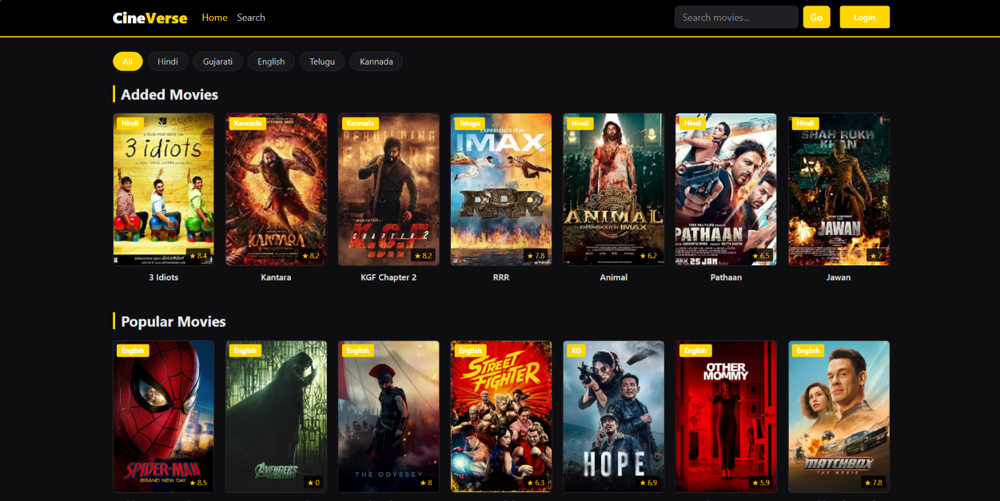
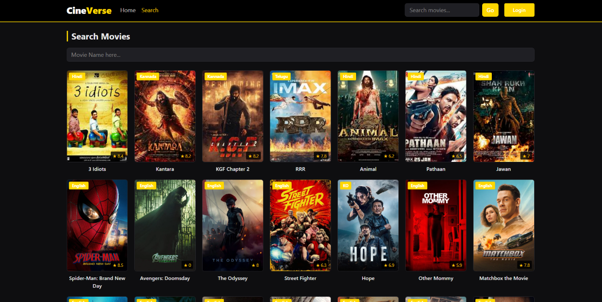
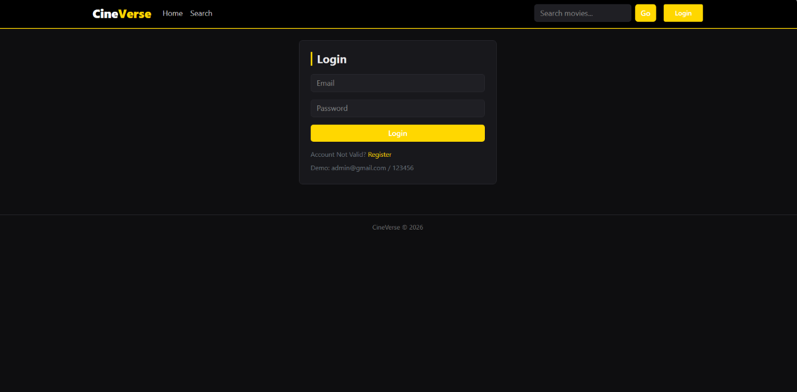
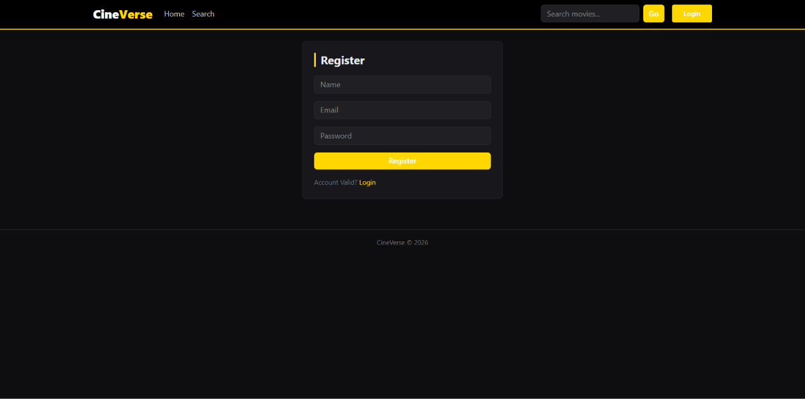
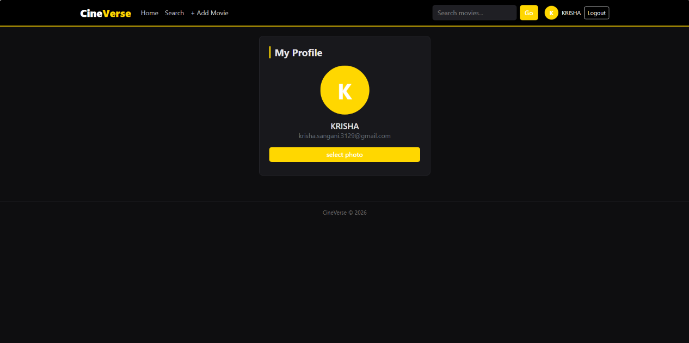
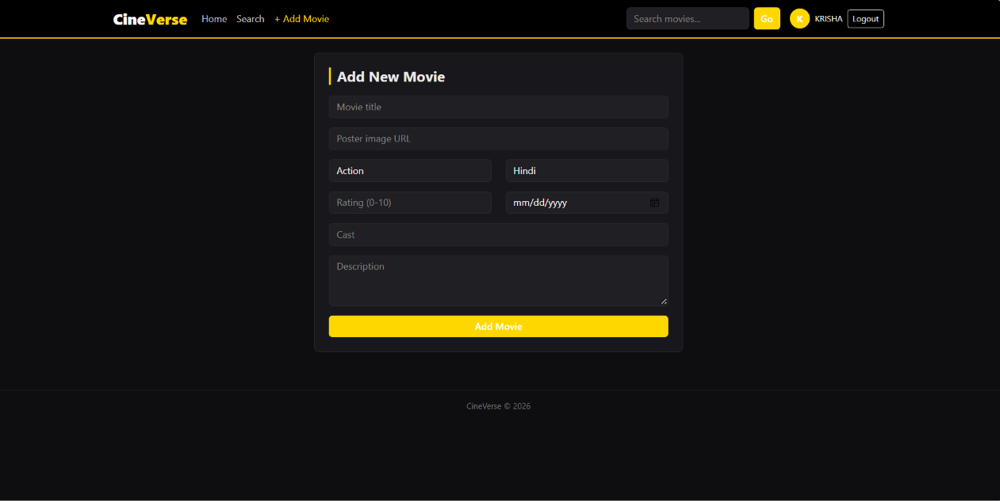
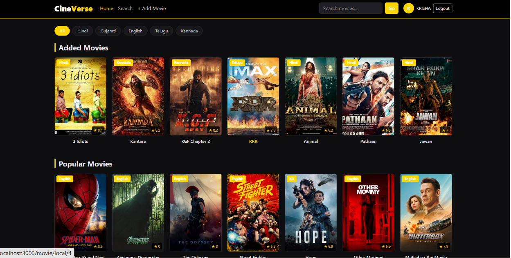

 # 🎬 CineVerse

CineVerse is a movie browsing application built with **React** and **Vite**. It lets users browse movies, search for titles, view movie details, log in, access a protected profile page, and add movies through a protected route.

## ✨ Features

- **Movie List** — Browse the available movie collection.
- **Movie Search** — Search for movies by title.
- **Movie Details** — Open a movie details page using its source and ID.
- **Login** — Sign in through the login page.
- **Protected Routes** — Restrict access to the profile and Add Movie pages.
- **Add Movie** — Add a movie through the protected Add Movie page.
- **Navigation Bar** — Navigate between application pages.
- **Redux Setup** — Redux actions, reducers, and store are organized in the `src/redux` folder.
- **Responsive Styling** — Styling is managed with `index.css` and Bootstrap utility classes (if Bootstrap is installed).

## 🧰 Tech Stack

- React
- Vite
- React Router DOM
- Redux (based on the project structure)
- CSS
- JavaScript / JSX

## 📁 Project Structure

```text
src/
├── components/
│   ├── AddMovie.jsx
│   ├── Login.jsx
│   ├── MovieCard.jsx
│   ├── MovieDetails.jsx
│   ├── MovieList.jsx
│   ├── MovieSearch.jsx
│   ├── Navbar.jsx
│   └── PrivateRoute.jsx
├── redux/
│   ├── actions.js
│   ├── reducers.js
│   └── store.js
├── App.jsx
├── index.css
└── main.jsx
db.json
index.html
package.json
package-lock.json
vite.config.js
```

> **Note:** File names are case-sensitive in many environments. The imports in `App.jsx` use `Navbar.jsx`; make sure the actual file name matches that capitalization. Also confirm that the Redux file names (`actions.js` vs `action.js`) match your imports.

## ⚙️ Getting Started

### 1. Install Node.js

Install a current LTS version of Node.js if it is not already installed.

### 2. Install dependencies

Open the project folder in a terminal and run:

```bash
npm install
```

### 3. Start the development server

```bash
npm run dev
```

Open the local URL shown in the terminal (usually `http://localhost:5173`).

### 4. Start the JSON Server (if the app uses `db.json`)

If your project uses JSON Server to provide movie data, open a **second terminal** and run:

```bash
npx json-server --watch db.json --port 3000
```

The JSON Server command requires `json-server` to be available in the project. If it is not installed, add it with:

```bash
npm install --save-dev json-server
```

## 🗺️ Application Routes

| Route | Page | Access |
|---|---|---|
| `/` | Movie List | Public |
| `/search` | Movie Search | Public |
| `/movie/:source/:id` | Movie Details | Public |
| `/login` | Login | Public |
| `/profile` | Profile | Protected |
| `/add-movie` | Add Movie | Protected |

## 🔐 Protected Pages

The `/profile` and `/add-movie` routes are wrapped with `PrivateRoute`. Their exact access behavior depends on the authentication logic implemented in `PrivateRoute.jsx` and `Login.jsx`.

## 🧪 Available Scripts

Common Vite scripts include:

```bash
npm run dev       # Start development server
npm run build     # Build for production
npm run preview   # Preview production build
```

These scripts depend on the entries configured in `package.json`.

## 🛠️ Troubleshooting

- **Module not found:** Check that each imported component exists and that the filename capitalization matches exactly.
- **React Router errors:** Ensure the app is wrapped in `BrowserRouter` in `main.jsx`.
- **JSON Server not responding:** Confirm it is running on port `3000` and that `db.json` contains valid JSON.
- **Missing package errors:** Run `npm install` and install any missing dependency used by the project.
- **Redux import errors:** Confirm the action file name and import paths match your actual project structure.

## 👨‍💻 Development

1. Clone or download the project.
2. Open the project directory in VS Code.
3. Run `npm install`.
4. Start the Vite server with `npm run dev`.
5. If needed, start JSON Server in a second terminal.

---

## 📷 Screenshots








## 👨‍💻 Author
Krisha Sangani

Made with using React and Vite.